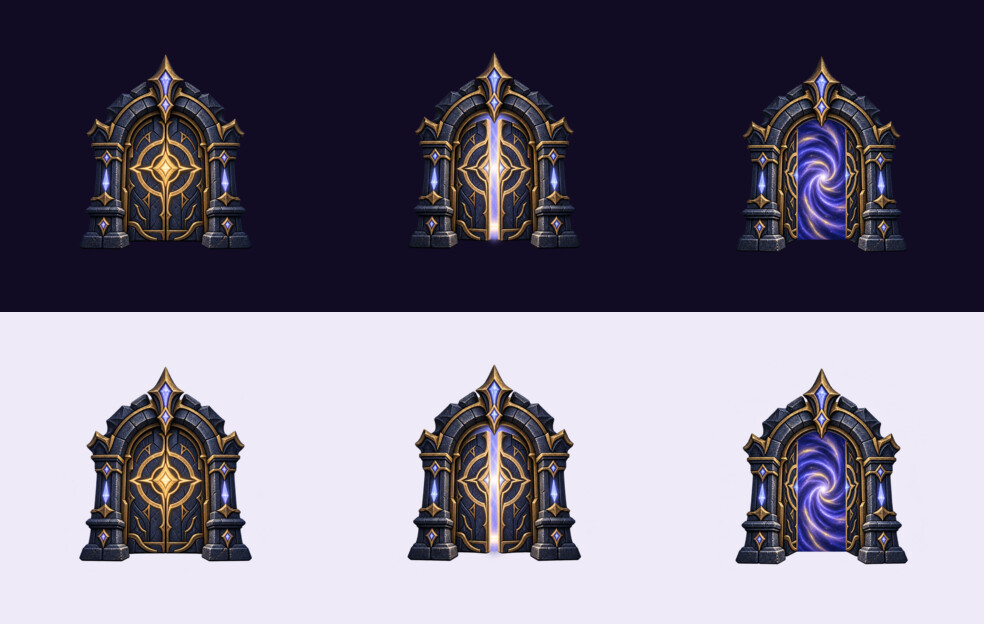
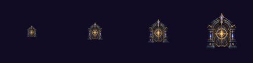

# G14 Global Loading Presentation Pack — Ver 1.1.18

Status: **PARTIAL — OWNER APPROVED / R2 + RUNTIME PR PREPARATION**

Issue: #150. Risk: **MEDIUM** (presentation assets and shared client UI only). No Worker,
API, D1, gameplay, economy, persistence, Battle Core or loading-token ownership changes.

## Approved artwork

Owner approved the navy/indigo stone and antique-gold three-frame Dungeon Gate family on
2026-10-26. The extra frames extend the originally planned static emblem with a short,
non-looping completion transition.

| State | Manifest key | R2 path | Dimensions | Bytes | SHA-256 |
| --- | --- | --- | ---: | ---: | --- |
| Closed | `loadingUi.gateEmblem` | `ui/loading/gate_emblem.png` | 256×256 RGBA | 65,241 | `ee0a7c0f71228e32ae4ed628bee114bbbd1434ebce3a9d2065f7bf91333863c5` |
| Opening | `loadingUi.gateEmblemOpening` | `ui/loading/gate_emblem_opening.png` | 256×256 RGBA | 65,464 | `21a79757d6fcd764d0d47b346688d4a33065a086cc493a5b883b630309a85749` |
| Open | `loadingUi.gateEmblemOpen` | `ui/loading/gate_emblem_open.png` | 256×256 RGBA | 67,336 | `42d665a0d229f67118267a3b958472ebd77058a5c66f70a1d4a484123eacd215` |

All frames retain real transparent alpha, at least 20 px safe padding on every edge, and
remain below the 100 KB target. `graphics/g14/QA.json` is the machine-readable record.
No separate rune-ring asset was created because the existing CSS rings already provide the
required motion and functional fallback.

## Runtime contract

- One neutral gate family is shared by every existing `GlobalLoadingOverlay` consumer.
- While work is active, the closed gate uses the existing CSS rings and a restrained glow.
- After the last loading owner releases, `closed → opening → open` crossfades for 360 ms and
  then the overlay leaves. The sequence does not loop.
- All three frames must decode before artwork replaces the CSS rune. A missing key, slow frame
  or image error keeps the existing CSS presentation and never delays dismissal.
- `prefers-reduced-motion: reduce` skips the completion sequence.
- Status, real progress, stale-owner Retry, z-index, safe-area behavior and token/reference
  ownership remain unchanged.
- App bootstrap and Login remain intentionally outside the shared overlay per the existing
  Owner decision in `GLOBAL-LOADING-SYSTEM-V1.md`; G14 does not create a second overlay.

## Verification before PR

- Technical artwork QA: **PASS 3/3**.
- Focused loading/asset/version tests: **34/34 PASS**.
- Full Node regression: **814/814 PASS**.
- `node build.js`: **PASS**, 71 modules; generated `index.html` SHA-256
  `37b68fb9063cd49614aae436a1f640db97c49ddd613c7940dce0e2b14cb674e2`.
- Browser QA at 360, 390 and 1280 px: 3/3 frames decoded, one overlay, z-index 2100,
  no horizontal overflow, completion animation PASS.
- Failure injection: CSS fallback PASS, one failed request, no retry, no blocked dismissal.
- Reduced motion: completion animation skipped and dismissal remains immediate.

## Release gates

- Owner artwork approval: **PASS**.
- Candidate + runtime PR: **PENDING**.
- R2 workflow upload/download SHA-256 verification: **PENDING MERGE**.
- Frontend deploy and live manifest/image decode: **PENDING MERGE**.
- Production presentation verification: **PENDING DEPLOY**.
- Branch cleanup: **PENDING MERGE + PRODUCTION VERIFICATION**.

G14 must remain PARTIAL until the pending release gates pass.
