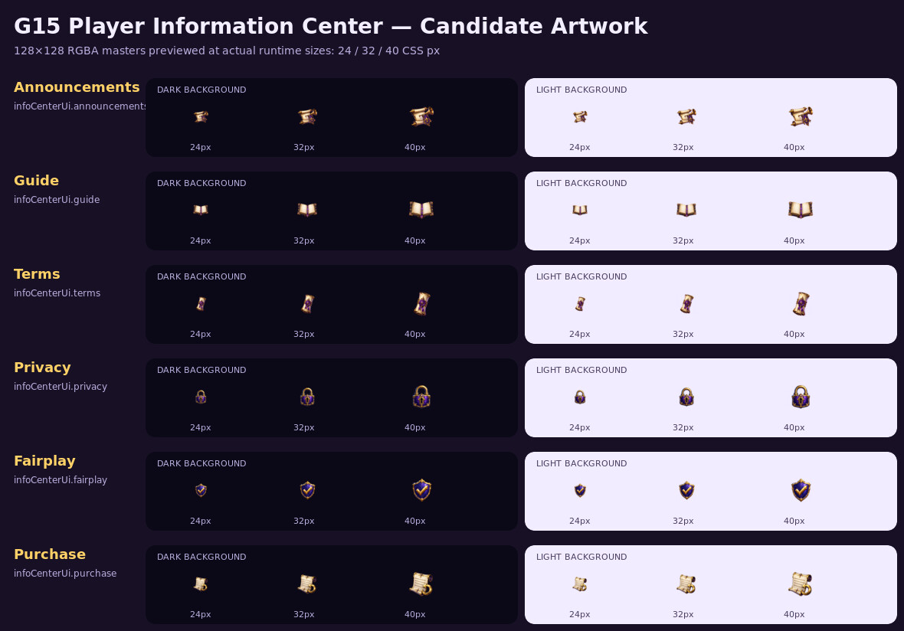

# G15 Player Information Center UI Pack

Issue: #152

Baseline: Ver 1.1.18 / `63b95d0e5025cfce5458f99b34341972cc3fda0d`

Risk: MEDIUM — player-visible artwork and later optional UI integration; no backend or gameplay authority

Status: **ARTWORK CANDIDATE / OWNER REVIEW**

## Delivery state

| Gate | State | Evidence |
| --- | --- | --- |
| Artwork Candidate | PASS — 6/6 | `docs/graphics/g15/*.png` and `PREVIEW.jpg` |
| Owner Approved | PENDING | Owner decision required before publication |
| R2 Published | NOT STARTED | No files staged under `r2-upload/ui/info-center/` |
| Runtime Integrated | NOT STARTED | Existing emoji UI remains unchanged |
| Production Verified | NOT STARTED | Blocked on approval, integration and deploy |

## Candidate contract

| Meaning | Candidate | Proposed manifest key | Proposed R2 path |
| --- | --- | --- | --- |
| Announcements | `announcements.png` | `infoCenterUi.announcements` | `ui/info-center/announcements.png` |
| Game Guide | `guide.png` | `infoCenterUi.guide` | `ui/info-center/guide.png` |
| Terms of Service | `terms.png` | `infoCenterUi.terms` | `ui/info-center/terms.png` |
| Privacy Policy | `privacy.png` | `infoCenterUi.privacy` | `ui/info-center/privacy.png` |
| Fair Play | `fairplay.png` | `infoCenterUi.fairplay` | `ui/info-center/fairplay.png` |
| Purchase / Refund Policy | `purchase.png` | `infoCenterUi.purchase` | `ui/info-center/purchase.png` |

All candidates are 128×128 RGBA PNG, contain real alpha, retain at least 12 px transparent
padding, and are below the 60 KB target. They use a shared dark-fantasy purple/gold finish,
strong silhouettes and no embedded text. The Purchase icon contains no currency sign, coin,
gem, card, cart or price tag and does not imply that real-money checkout is enabled.

## Review and publication boundary

The six files in `docs/graphics/g15/` are review candidates, not production R2 assets.
Approval of the artwork authorizes the next gate only; it does not itself prove R2 upload,
runtime integration, deployment or Production acceptance.

After approval:

1. Copy only approved optimized icons to `r2-upload/ui/info-center/`.
2. Add `assets.infoCenterUi` to the R2 manifest without changing existing groups.
3. Use the shared optional manifest resolver; preserve current emoji fallback for missing
   keys and image load errors, with no retry loop or layout shift.
4. Preserve navigation, deep links, scrolling, NEW badge and roadmap status text.
5. Run focused and full regression, build/generated-file checks, responsive browser QA,
   R2 SHA validation, deployment and live decode verification.

## Known limitations at this gate

- Static preview QA is complete; browser runtime/responsive behavior is not yet exercised.
- No live R2 object or manifest entry exists for G15 yet.
- Owner artwork approval is pending.
