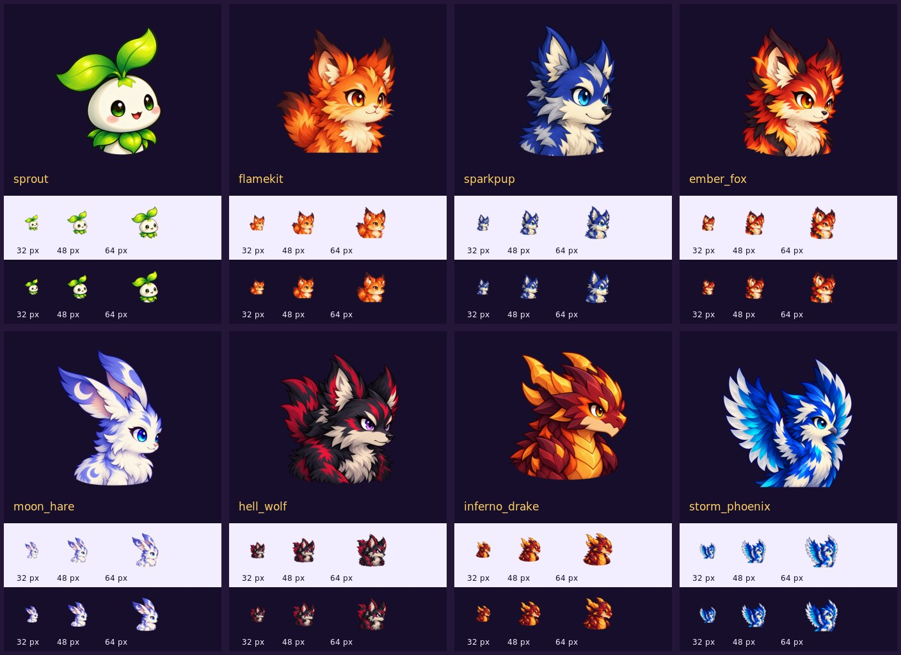

# G13 delivery audit and G14–G15 asset preparation

This is the historical audit/review-candidate record. Owner subsequently approved
all 8 images and authorized full integration. Current status and release evidence:
[G13-PET-AVATAR-INTEGRATION.md](G13-PET-AVATAR-INTEGRATION.md).
The audit-time pending approvals and DEV-only handoff below are superseded by that integration.

Audit date: 2026-10-26 (Asia/Bangkok). Issue: #146.
Baseline: main `d96cb5c5eacdba5bd9e06e6a25fadf3454a53558`, Ver 1.1.14.
Pre-publication recheck: main `e203856172a0f0646f85aa51068381f3d590fd6e`, Ver 1.1.15 (#147).
Reviewed intervening changed paths/diff: PR-D overlay work does not alter G13 catalog, manifest,
Pet picker/portrait consumers or G14/G15 graphics requirements. Review delivery rebased on that main.
Risk: LOW inventory/documentation; MEDIUM new artwork/publication.
Status: PARTIAL. Repository inventory complete; production G13 completion remains gated by artwork acceptance, integration and live verification. Eight new portrait candidates now pass local technical and visual preview checks; none has been published to R2.

## Evidence and existing inventory

Read AGENTS.md, ACTIVE-DEVELOPMENT-ROADMAP-V3.md, PET-AVATAR-CONTRACT-G13.md,
GLOBAL-LOADING-SYSTEM-V1.md §7, PLAYER-INFORMATION-CONTENT-POLICY.md §7,
r2-upload/README.md, both manifests, relevant UI consumers and upload workflow.

Actual tracked files, not roadmap status, establish **0 existing dedicated avatars / 8 missing** at baseline.
`r2-upload/manifest.json` has no `petAvatars` group. R2 inventory snapshot
`src/data/r2-manifest.json` generated 2026-10-26T01:14:49Z contains 726 objects,
no Pet portrait paths; its only avatar-named files are the shared Player Card frame and placeholder.
The snapshot is not a live bucket listing. Public Production `/assets/manifest.json`
probe returned HTTP 403 from this execution environment; absence from live R2 is unconfirmed.

| Pet ID / identity | Baseline portrait | Proposed manifest key | Reserved R2 path |
| --- | --- | --- | --- |
| sprout / Sprout | Missing | petAvatars.sprout | ui/pet-avatars/sprout.png |
| flamekit / Flamekit | Missing | petAvatars.flamekit | ui/pet-avatars/flamekit.png |
| sparkpup / Sparkpup | Missing | petAvatars.sparkpup | ui/pet-avatars/sparkpup.png |
| ember_fox / Ember Fox | Missing | petAvatars.ember_fox | ui/pet-avatars/ember_fox.png |
| moon_hare / Moon Hare | Missing | petAvatars.moon_hare | ui/pet-avatars/moon_hare.png |
| hell_wolf / Hell Wolf | Missing | petAvatars.hell_wolf | ui/pet-avatars/hell_wolf.png |
| inferno_drake / Inferno Drake | Missing | petAvatars.inferno_drake | ui/pet-avatars/inferno_drake.png |
| storm_phoenix / Storm Phoenix | Missing | petAvatars.storm_phoenix | ui/pet-avatars/storm_phoenix.png |

For every missing baseline portrait: dimensions/format/encoded size/alpha = N/A;
rendering = unavailable; artwork approval = none found. Keys above are proposals,
not existing runtime entries. Required export is 256×256 PNG alpha, head/upper torso,
no text. New family safe padding proposal: ≥20 px each side (content in 216×216),
uniform scaling only; no clipping of ears, horns, leaves or feathers.
Target ≤120 KB, hard limit 200 KB (small UI class, conservative choice).

Approved identity references are the existing idle battle frames. All eight families
contain 3 Idle + 3 Attack + 1 Death frames. All 56 files decode at 512×512 and
have genuine alpha coverage (0–255 after RGBA conversion). Portraits must not replace these animations.

| Pet | Existing idle reference | Canvas | Format/mode | Encoded bytes |
| --- | --- | --- | --- | ---: |
| sprout | sprite/pet/sprout001/animations/sprout_idle_0.png | 512×512 | PNG RGBA | 128254 |
| flamekit | sprite/pet/flamekit/animations/flamekit_idle_0.png | 512×512 | PNG indexed + transparency | 39725 |
| sparkpup | sprite/pet/sparkpup/animations/sparkpup_idle_0.png | 512×512 | PNG indexed + transparency | 43668 |
| ember_fox | sprite/pet/ember_fox/animations/ember_fox_idle_0.png | 512×512 | PNG RGBA | 188026 |
| moon_hare | sprite/pet/moon_hare/animations/moon_hare_idle_0.png | 512×512 | PNG RGBA | 144784 |
| hell_wolf | sprite/pet/hell_wolf/animations/hell_wolf_idle_0.png | 512×512 | PNG RGBA | 183227 |
| inferno_drake | sprite/pet/inferno_drake/animations/inferno_drake_idle_0.png | 512×512 | PNG RGBA | 197356 |
| storm_phoenix | sprite/pet/storm_phoenix/animations/storm_phoenix_idle_0.png | 512×512 | PNG RGBA | 205911 |

## Runtime handoff to DEV (no runtime edits by Graphics)

- Add one shared `petAvatarUrl(defId)` resolver over `ASSETS.petAvatars`; use authoritative Pet ID, not instance ID. Portrait `sprout` must not accidentally use battle alias `sprout001` as its key. Existing battle alias remains untouched.
- Reuse it in PetRoster/Pets details, Arena Setup and portrait surfaces in Arena; future Player Card consumes the same resolver. Do not substitute portraits for Phaser battle actors or the generic ATB Pet role icon.
- `src/ui/components.js` Arena Setup already uses `
/
` and button rows, **not a native select**. `arenaSetupPetIcon()` resolves catalog emoji, falling back to 🐾. Preserve this selector; replace visual slots only. Selected summary currently omits level: add it per G13 contract.
- PetRoster uses `def.icon`; Gacha result uses `gachaResult.pet.icon`. Keep catalog emoji as failed/missing-image fallback, and 🐾 for unknown/no Pet. Missing image must not retry infinitely or alter selection/setup.
- PetCombatSprite uses `getPetSpriteConfig()` + AnimatedFrameSprite with `pet.icon` fallback; keep animation path unchanged. Arena Player Card currently formats Pet name/level as text.
- Suggested display checks: 32, 40, 48, 64, 96 CSS px; mobile 360/390 px and desktop 1280 px. These are QA targets, not claims of browser testing.
- DEV owns build, focused UI tests, fallback failure injection, visible patch bump and deployment. Graphics has changed no Worker/D1/gameplay/runtime UI.

## G14 completed delivery — Issue #150 / PR #151 / Ver 1.1.18 Production

No existing `loadingUi` manifest group or dedicated loading pack found. Current
GlobalLoadingOverlay.js has a CSS rune/rings at 76×76 over dark purple radial gradient.
Retain runtime label/progress/retry and reduced-motion support; artwork never owns progress.
Use the current gold `#FFD166`, muted lavender `#B9AEDD`, dark purple identity.

| Priority | Filename under r2-upload/ | Manifest key proposal | Canvas / format | Target / hard limit |
| --- | --- | --- | --- | --- |
| Required / approved | ui/loading/gate_emblem.png | loadingUi.gateEmblem | 256×256 alpha PNG, ≥20 px padding | 65,241 B / PASS |
| Owner-approved completion frame | ui/loading/gate_emblem_opening.png | loadingUi.gateEmblemOpening | 256×256 alpha PNG, ≥20 px padding | 65,464 B / PASS |
| Owner-approved completion frame | ui/loading/gate_emblem_open.png | loadingUi.gateEmblemOpen | 256×256 alpha PNG, ≥20 px padding | 67,336 B / PASS |

Owner approved the three-frame `closed → opening → open` extension on 2026-10-26. Keep current
CSS background/vignette: no extra mobile/desktop background files or GIF/video are needed.
One neutral gate/rune works for initial load and scene transitions, no Dungeon/Arena words.
Optional ring must contribute visible value beyond the existing CSS rings, otherwise omit it.
DEV should retain CSS emblem until image decoding succeeds and on error; a missing decorative
image must never acquire loading ownership or block ready state. Budget applies to initial
payload; do not preload unused animation frames. G14 production waits for G13 Graphics acceptance.

## G15 delivery — Issue #152 / PR #153 / Ver 1.1.19 release gate

Status: **DONE / PRODUCTION VERIFIED**. Baseline `main` was Ver 1.1.18 at
`63b95d0e5025cfce5458f99b34341972cc3fda0d`. Risk is MEDIUM: new player-facing
artwork and later optional runtime integration, with no Worker/API/D1/gameplay/data authority change.

Current Info Center uses data-driven emoji for six live sections, runtime NEW text,
and completed/in_progress/planned roadmap groups. No dedicated infoCenterUi family found.
Reviewed manifest families itemIcons, inventoryUi, petUi and arenaUi. Existing
`arenaUi.icons.info` (`ui/arena/icons/icon_info.png`) is a blue/gold information medallion:
reuse it for a generic Information Center entry if needed, rather than drawing another
info icon. Pet role badges and protectionStone/currency/recipe icons have gameplay-specific
meanings and should not be relabeled as policies. None of the six section-specific icon
semantics has a dedicated existing manifest entry. Reuse existing art only where
semantics/style match. Do not repurpose the currency Diamond icon to imply purchasing is enabled.

| Filename under r2-upload/ui/info-center/ | Manifest key proposal | Motif |
| --- | --- | --- |
| announcements.png | infoCenterUi.announcements | scroll/announcement horn |
| guide.png | infoCenterUi.guide | open book |
| terms.png | infoCenterUi.terms | sealed scroll |
| privacy.png | infoCenterUi.privacy | closed lock |
| fairplay.png | infoCenterUi.fairplay | shield/check |
| purchase.png | infoCenterUi.purchase | receipt, no price/currency amount |

All six: 128×128 alpha PNG, ≥10 px padding, ≤60 KB target / 200 KB hard limit,
readable at 24–40 CSS px. Match purple/gold UI and existing painted icon finish.
No extra raster asset for NEW: use runtime text inside existing reusable badge styles.
Public roadmap: reuse runtime Completed/In Development/Planned labels, optionally pair
existing check/clock/dot primitives with text; do not bake text or depend on color alone.
No background/card/tab/button/accordion/table artwork required. No extra icons for reserved
Account/Support/Credits scope. Runtime typography, legal drafts, guide values and layout remain DEV/content ownership.
Production publication completed through merged PR #153 for Ver 1.1.19.

Six candidate icons were generated with the built-in imagegen workflow, normalized to
128×128 RGBA with 12 px or greater transparent padding, and kept under
`docs/graphics/g15/` outside the R2 auto-upload path. `PREVIEW.jpg` shows every icon on
dark and light backgrounds at the actual 24/32/40 px target sizes. Exact dimensions,
alpha bounds, byte sizes and SHA-256 hashes are recorded in `QA.json`; prompts and the
additive-only manifest proposal are recorded beside the artwork.

All six candidates pass local decode, alpha, safe-padding, budget, duplicate-hash and
small-size visual checks. The existing Arena information medallion remains the recommended
reuse for a generic Information Center entry; none of the six section meanings had a
semantically correct reusable production icon. No NEW badge, roadmap status, card,
background, tab, accordion, table or reserved Account/Support/Credits artwork was created.

Owner approved all six candidates. Identical optimized bytes are now staged under
`r2-upload/ui/info-center/`, the manifest gains the additive `infoCenterUi` group, and the
Information Center uses a shared optional resolver with fixed-size decorative images and the
existing emoji as missing-key/decode-error fallback. Data/content, NEW badge, roadmap text,
navigation and deep-link contracts are unchanged. R2 publishing, deploy and Production
verification passed after the combined-task release gate.

Production evidence: PR #153 merged as `2ceb79ea2aa6d029376698070cc7ff0b9ddf827f`;
R2 run #40333086818 uploaded and read-back SHA-verified all six icons; frontend run
#40333086817 deployed and verified the Production endpoint; direct live decode and SHA checks
passed 6/6 on 2026-10-27. Focused tests passed 48/48 and full Node regression passed 823/823.

## Publication and acceptance

Portrait candidates must stay outside `r2-upload/` until visual/alpha QA passes.
New artwork approval and production completion are distinct; never mark G13 COMPLETE on file creation alone.
After acceptance, copy only eight optimized files into `r2-upload/ui/pet-avatars/` and
add `assets.petAvatars` to `r2-upload/manifest.json` without altering existing groups.
Do not manually edit the generated R2 inventory snapshot.

Main-path staging triggers `.github/workflows/upload-r2-assets.yml`; changed supported
files are uploaded, downloaded and SHA-256 compared. Deletion does not remove R2 objects.
Verify workflow success and each object hash, then live `/assets/ui/pet-avatars/<id>.png`
decode/headers and `/assets/manifest.json` entries, then DEV integration and mobile browser QA.
No R2 publication, deployment, live avatar rendering or production approval is claimed by this audit.

Exact next action: review and accept the locally QA-passed portrait family before staging;
hand the shared resolver and consumer work to DEV.

## New G13 candidate delivery / QA result

Eight portraits generated with the built-in imagegen skill, one call per Pet using
its approved idle frame as identity reference. Originals remain masters; only optimized
256×256 exports are committed under `docs/graphics/g13/`, outside auto-upload staging.
ImageMagick performed uniform resize/transparent padding and metadata removal, no repainting.
Prompt set is recorded in `graphics/g13/PROMPTS.md`.

| Candidate | Dimensions / format | Encoded bytes | Technical QA | Local visual QA | Approval / R2 |
| --- | --- | ---: | --- | --- | --- |
| sprout.png | 256×256 RGBA PNG | 44251 | PASS | PASS | Pending / not uploaded |
| flamekit.png | 256×256 RGBA PNG | 59509 | PASS | PASS | Pending / not uploaded |
| sparkpup.png | 256×256 RGBA PNG | 56176 | PASS | PASS | Pending / not uploaded |
| ember_fox.png | 256×256 RGBA PNG | 58813 | PASS | PASS | Pending / not uploaded |
| moon_hare.png | 256×256 RGBA PNG | 50837 | PASS | PASS | Pending / not uploaded |
| hell_wolf.png | 256×256 RGBA PNG | 67723 | PASS | PASS | Pending / not uploaded |
| inferno_drake.png | 256×256 RGBA PNG | 64237 | PASS | PASS | Pending / not uploaded |
| storm_phoenix.png | 256×256 RGBA PNG | 72132 | PASS | PASS | Pending / not uploaded |

All 8 decode, contain 0–255 alpha, meet ≥20 px transparent safe padding on each side,
and stay below the conservative 120,000-byte target. No duplicate SHA-256 among exports.
`graphics/g13/QA.json` records exact alpha bounds, padding, bytes, keys, paths and hashes.
`graphics/g13/MANIFEST-PROPOSAL.json` is documentation only, not a loaded manifest.

Visual preview reviewed on dark purple and pale backgrounds at 32/48/64 px and larger:
identity, silhouette and palette remain distinguishable; no visible fringe at preview sizes.
High-resolution generation had minor baseline specks; normalized production-size previews
show no visible stray edge at the reviewed sizes. This is static compositing QA, not
browser/Production rendering, interaction testing or Owner artwork approval.
Small thumbnails should not be circularly cropped: Moon Hare ears, Sprout leaves and
Phoenix feathers need the full square; labels remain runtime text.

Counts: baseline existing 0, baseline missing 8; newly created local candidates 8;
locally QA-passed exports 8; approved/published production avatars 0; complete G13
runtime/Production deliveries 0. No existing assets, runtime source, live manifest,
Worker, D1 or production paths modified. No build required for documentation/review assets.
G14/G15 specifications are ready for Lead review; no G14/G15 artwork was produced.

Exact next action: Project Lead review the eight concrete candidates; once accepted and
publication authorized, stage these exports and additive manifest group, verify upload
workflow SHA-256 and live decoding, then assign DEV the shared resolver/consumer integration.

Copy-ready Lead handoff:
> #146 PARTIAL — audited baseline Ver 1.1.14 d96cb5c; latest main recheck Ver 1.1.15 e203856. Baseline G13 0 existing/8 missing;
> produced 8 candidate portraits (256×256 RGBA PNG, 44,251–72,132 bytes), local
> decode/alpha/padding/budget/duplicate/32–64 px preview QA 8 PASS. Review
> docs/GRAPHICS-G13-G15-DELIVERY.md and docs/graphics/g13/PREVIEW.jpg. No R2/runtime
> publication or UI edits; live manifest probe returned 403. G14/G15 specs prepared.
> Next: accept artwork + authorize staging, verify R2 upload hashes/live paths, assign
> DEV shared petAvatars resolver and existing custom picker/Pets/Arena consumers.
