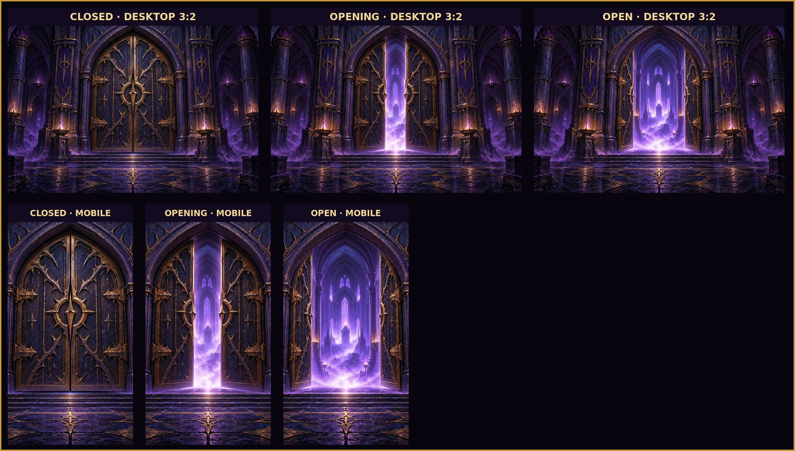

# G14 Fullscreen Dungeon Gate Upgrade — Artwork Review

Status: **OWNER APPROVED / R2 STAGED / RUNTIME INTEGRATED — PRODUCTION PENDING**

Package: Combined Graphics Task, Package B

## Candidate sequence

| State | File | Dimensions | SHA-256 |
| --- | --- | ---: | --- |
| Closed | `closed.jpg` | 1536x1024 RGB | `b85badc18c003d8e93aa48bfbb36d4a3ad63dbfb48baa09a6b93284ee656ff33` |
| Opening | `opening.jpg` | 1536x1024 RGB | `f64db9fdf5b13d7299539db5c9efd05fdbe308c36a55b4bb1e7df41e9055feb2` |
| Fully Open | `open.jpg` | 1536x1024 RGB | `750a45fe382fd4758e0067af8e8d572e3c806e586729a4cc6cd35b3148c171c4` |

The preview includes the 3:2 desktop master and a centered 9:16 crop representing the narrow mobile safe composition. Runtime loading text, progress, retry, and safe-area controls remain DOM text and are intentionally absent from the artwork.

## Intended runtime after approval

- closed artwork covers the viewport during loading;
- one-shot Closed -> Opening -> Fully Open exit sequence;
- reveal the game only after the open transition completes;
- CSS ring/spinner appears only as a lightweight asset-failure fallback;
- `prefers-reduced-motion` jumps to the final open state without animated transitions.

Owner approved all three frames on 2026-10-26. Optimized 1536x1024 WebP derivatives are staged under
`r2-upload/ui/loading/fullscreen/` and mapped additively as `loadingUi.fullscreenGateClosed`,
`loadingUi.fullscreenGateOpening`, and `loadingUi.fullscreenGateOpen`. The approved review JPGs remain
immutable evidence; production hashes and encoded sizes are recorded in `PRODUCTION-QA.json`.

Runtime now fills the viewport using a centered `object-fit:cover` crop, places loading text/progress in
the safe-area-aware DOM layer, and plays a non-looping 900 ms Closed -> Opening -> Fully Open sequence.
Reduced Motion shows the final Open frame without animation. CSS rings are rendered only when a manifest
key is missing or image decoding fails. Publication and live decode remain pending the merge/release gate.

## Generation record

The Closed master was generated as an original dark-fantasy Purple/Gold dungeon gate with no text, UI, characters, or spinner. Opening and Fully Open were reference edits of the immediately preceding state, restricted to door position, portal illumination, and mist to preserve scene continuity.
